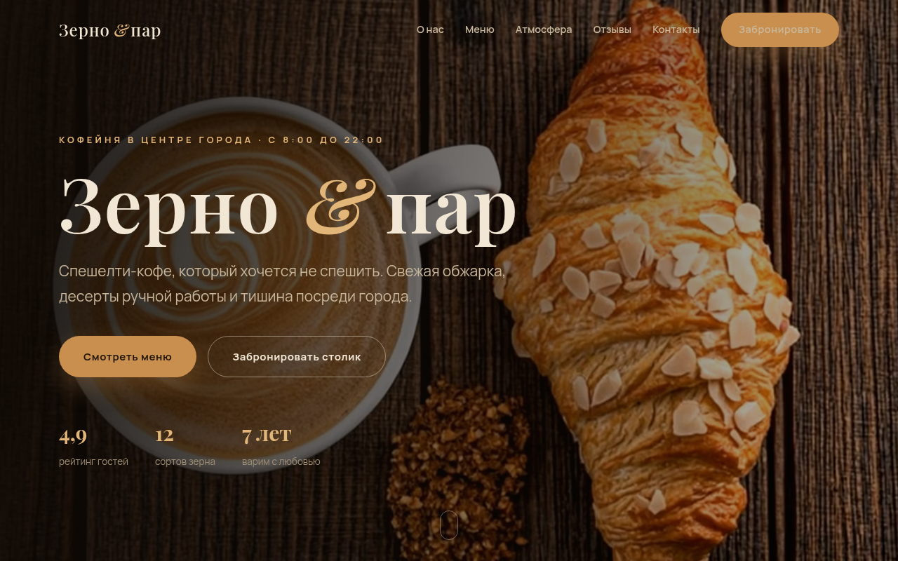
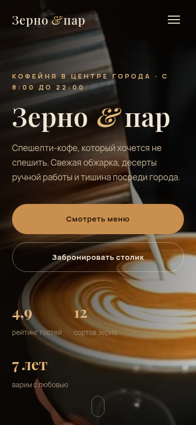

# Зерно и пар — сайт кофейни

## Демо

**[Открыть сайт →](https://shalim-andrej.github.io/kofeynya-zerno-i-par/)**




Одностраничный сайт кофейни спешелти-кофе с видео-заставкой в первом экране, меню и онлайн-бронированием столика.

**Демо:** [shalim-andrej.github.io/kofeynya-zerno-i-par](https://shalim-andrej.github.io/kofeynya-zerno-i-par/)

## О проекте

Концепт-сайт вымышленной кофейни «Зерно и пар» — портфолио-кейс для общепита, где сайт продаёт атмосферу ещё до визита. Первый экран — не статичная картинка, а живое видео: пар, проливка эспрессо, движение зала. Дальше меню с напитками и десертами, фото-блок атмосферы, отзывы и форма брони столика.

Вёрстка написана с нуля, без конструкторов и фреймворков: чистые HTML, CSS и JavaScript.

## Структура страницы

| Блок | Задача |
|---|---|
| Первый экран | видео-заставка, айдентика кофейни |
| О нас | история и ценности |
| Меню | напитки и десерты |
| Атмосфера | фотографии интерьера и зала |
| Отзывы | гости о кофейне |
| Контакты | адрес, часы работы |
| Забронировать | форма брони столика |

## Технологии

- **HTML5-видео** в первом экране — атмосфера вместо статичной картинки
- **CSS3** — Flexbox и Grid, адаптив от смартфона до широкого монитора
- **JavaScript (vanilla)** — вся интерактивность без внешних библиотек
- **Форма бронирования** — столик на нужную дату и время
- **SEO-база** — `<title>` с нишей и локацией, `meta description`

## Запуск локально

```bash
git clone https://github.com/shalim-andrej/kofeynya-zerno-i-par.git
cd kofeynya-zerno-i-par
```

Откройте `index.html` в браузере — сборка и зависимости не нужны.

## Автор

Разработчик — Андрей Шалимов ([@shalim-andrej](https://github.com/shalim-andrej)).
Заказать сайт: [Kwork](ССЫЛКА_НА_ПРОФИЛЬ_KWORK)

> Проект демонстрационный: бренд вымышленный, сайт создан как портфолио-кейс.